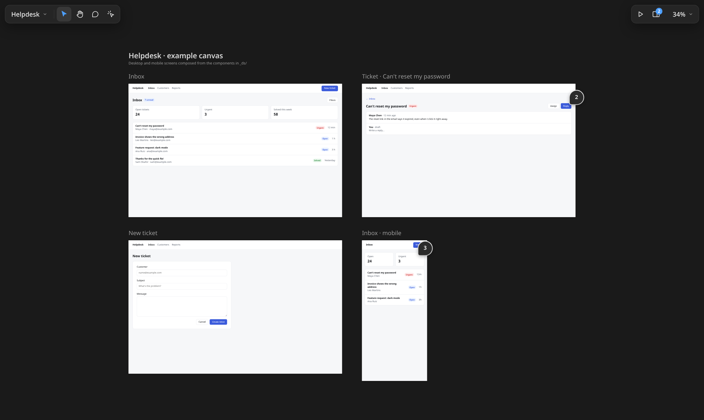
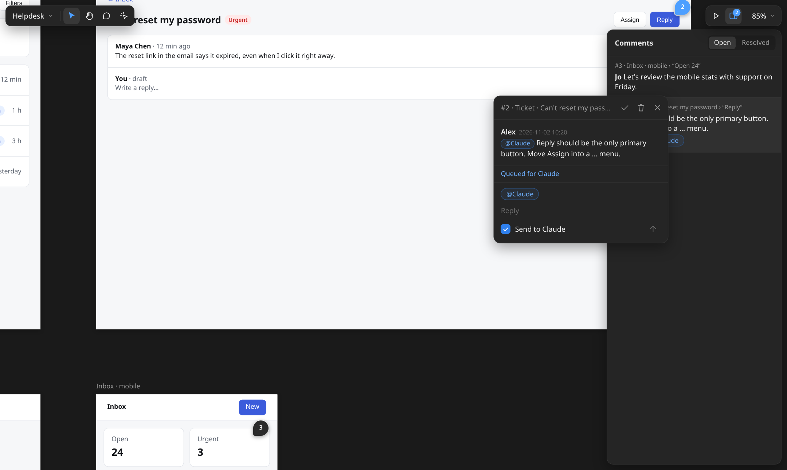
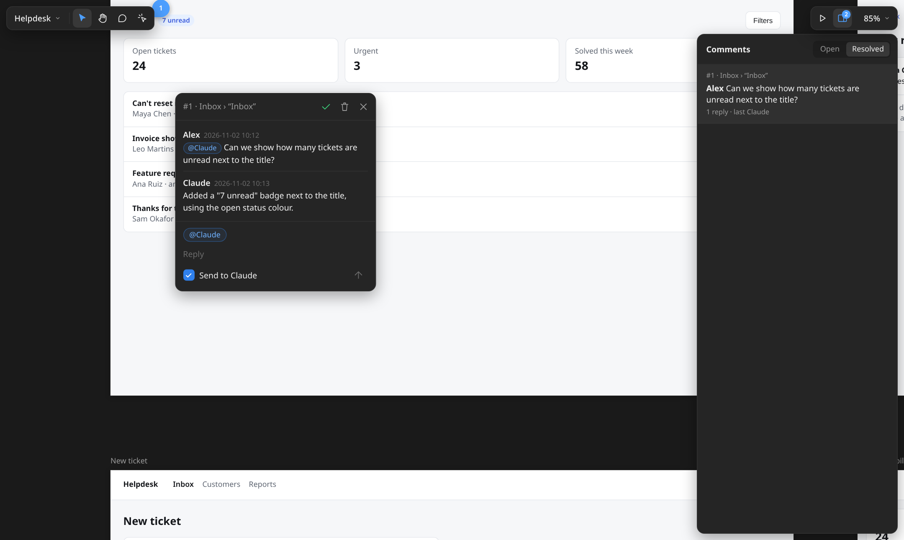
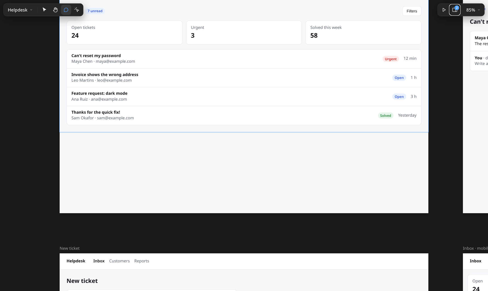

# Local Design Canvas

**An offline design canvas for [Claude Code](https://claude.com/claude-code).** Every HTML file in a folder becomes a live screen on a pan-and-zoom canvas. You pin comments on any element, tick **Send to Claude**, and Claude edits the screen and replies in the thread.

Tired of big design pages that freeze, break or run out of memory? Here the design experience stays smooth however many screens you have, and Claude spends far fewer tokens: it reads only the open comments and changes only the screen each one is about.



- **Your files, offline.** Screens are plain HTML in your repo. No account, no cloud, no build step, no dependencies.
- **Built for Claude.** Claude reads a compact list of open comments, edits only the file each one points to, and answers in the thread. It can also watch the canvas and answer as comments arrive.
- **Reusable components.** Compose screens from your own atoms, molecules, organisms and templates (`<ds-button>`, `<ds-data-table>`…), so every screen stays short and consistent.
- **Any screen size.** Desktop, tablet and mobile screens sit side by side.

## Quick start

You need Node 20 or newer.

**As a Claude Code plugin** (the canvas skill, the `canvas` command for Claude, and a start-of-session hook):

```
/plugin install local-design-canvas --marketplace fogelman/local-design-canvas
```

On older Claude Code, use two steps: `/plugin marketplace add fogelman/local-design-canvas`, then `/plugin install local-design-canvas@local-design-canvas`.

**Or as a command-line tool:**

```bash
git clone https://github.com/fogelman/local-design-canvas && cd local-design-canvas
npm link
canvas open examples/demo   # opens the example canvas in your browser
```

Then, in a Claude Code session inside your project:

> Design the checkout screens on a canvas in docs/checkout/canvas

## How it works with Claude



1. Press **C** and click any element of a screen. Write your comment and keep **Send to Claude** checked. To show what you mean, paste, drop or attach (📎) images: a screenshot, a reference, a sketch. Claude opens them. Unchecked comments are notes between people; Claude ignores them.
2. Claude runs `canvas comments` and gets a few lines per thread: the file, the exact element and your message.
3. Claude edits that one file. The screen reloads in your browser, keeping your scroll position and anything you're typing.
4. Claude replies in the thread and resolves it, or asks you a question. Not happy with the result? Reply in the thread. Replying reopens a resolved thread, and with **Send to Claude** checked it goes back to Claude.



**Watch mode (optional).** The first time a session opens a canvas, Claude asks whether to answer comments automatically. If you say yes, it waits in the background at no cost and picks up comments as you send them, a few seconds after the last one. Threads show **Queued for Claude**, then **Claude is working…**, then the reply.

## Components

Build screens from your design system instead of raw markup. Components live in your canvas at `_ds/components/{atoms,molecules,organisms,templates}/`:

```html
<ds-topbar active="Inbox"><ds-button href="new-ticket.html">New ticket</ds-button></ds-topbar>
<ds-ticket-row subject="Can't reset my password" status="urgent" label="Urgent"></ds-ticket-row>
```

The server expands them when it serves a screen, so the browser, comments and screenshots see plain HTML. In comment mode, the outline names the component under your cursor, and a comment records which component it's in. Claude can then fix the component once, or just that one use.



A component is a small HTML file:

| Syntax | Meaning |
|---|---|
| `{{label}}`, `{{label\|default}}` | An attribute's value |
| `{{?href}}…{{/href}}`, `{{!href}}…{{/href}}` | Only when the attribute is set (`?`) or not set (`!`) |
| `{{@items:<li>$</li>}}` | Repeat for each comma-separated item. `Label:icon` items give `$` and `$2`; `$=active` marks the current item; `{{@items\|A,B::…}}` sets a default |
| `<slot></slot>`, `<slot name="actions">` | The tag's children, or the content of `<template slot="actions">` |

Start the file with a one-line `<!-- usage -->` comment, so `canvas ds` can list it. The tool ships no design system; [`examples/demo/_ds`](examples/demo/_ds) shows a small one.

## Commands

| Command | What it does |
|---|---|
| `canvas create <dir>` | Make a folder a canvas (creates it if needed) |
| `canvas open [dir]` | Serve a canvas and open it in the browser. `canvas [dir]` is short for it. It never creates folders, so a typo fails instead of making an empty canvas |
| `canvas list` | Canvases being served right now, with their URL and folder (`--json` for scripts) |
| `canvas new <name> [WxH]` | Create a screen (for example `canvas new inbox-mobile 390x844`) |
| `canvas comments [--open\|--all]` | Threads waiting for Claude (default), all open threads, or everything |
| `canvas reply <id> "text" [--image f.png] [--resolve]` | Answer a thread, optionally with images |
| `canvas resolve <id>` · `canvas reopen <id>` | Close or reopen a thread |
| `canvas watch on\|off` | Should Claude answer comments as they arrive? |
| `canvas wait` | Wait until comments are sent to Claude, then print them (Claude runs this in the background) |
| `canvas ds` | List the canvas's components |
| `canvas shot <screen or thread>` | Save a PNG of a screen, using headless Chrome |

Add `--dir <canvas>` when you're not inside the canvas folder.

## In the browser

| Key | Action |
|---|---|
| V | Move and resize screens. Changes wait in a **Save / Discard** bar (Ctrl+S saves) |
| H, or hold Space | Pan |
| C | Comment on any element |
| I | Use the live screen: click, type, scroll. Links to other screens fly you there |
| P | Present full screen. ← → steps through screens and follows links between them |
| Scroll · Ctrl+scroll | Pan · zoom |
| Shift+1 · Shift+0 · Shift+2 | Fit everything · 100% · the selected screen |
| R | Apply waiting updates (see below) |

Pages are subfolders: use the page menu at the top left to switch, add, rename or delete them.

**Updates never interrupt you.** When Claude changes a screen, it reloads right away, unless you're writing a comment or using a screen in interact mode. Then the screen gets an amber mark, and an amber **Reload** button appears at the top right. Click it, or press R, when you're ready.

## A canvas folder

```
docs/checkout/canvas/        # lives in your project's repo
  cart.html                  # one HTML file per screen
  payment.html               # set its size with <meta name="canvas:size" content="390x844">
  _ds/                       # optional design system: ds.css + components/
  canvas.json                # screen positions and section titles (written by the viewer)
  comments.json              # comment threads
  mobile/                    # a subfolder is another page
```

The canvas tool is only the server, the viewer and the command line. The files belong to your project, and git tracks them like any other file.

**Generated screens.** A build script can write the screens instead, for example from specs. If its `canvas.json` has a `"source"` note, Claude changes that source and rebuilds instead of editing the generated HTML.

## Performance

Only the screens near your view run as live pages, at most 12, and zoomed out below 50% a screen stays a picture. Pictures match the live page exactly and are saved in the browser, so reopening a page shows them all at once. Until a screen has one it shows diagonal stripes, and when the screen or anything it uses changes (a stylesheet, an image, data, a component), its picture gives way to stripes at once until a picture of the new version is ready. A picture is taken only once the page has finished drawing. A screen whose current state a picture can't hold (scrolled, an open modal, video or canvas) keeps the stripes rather than show something different. While you pan or zoom nothing loads or renders: that waits until the view is still. After 15 seconds in a hidden tab, the canvas releases everything and reloads what's in view when you come back. Hundreds of screens on one page stay smooth.

## Contributing

Bug reports, ideas and pull requests are welcome. See [CONTRIBUTING.md](CONTRIBUTING.md).

## License

[MIT](LICENSE).
